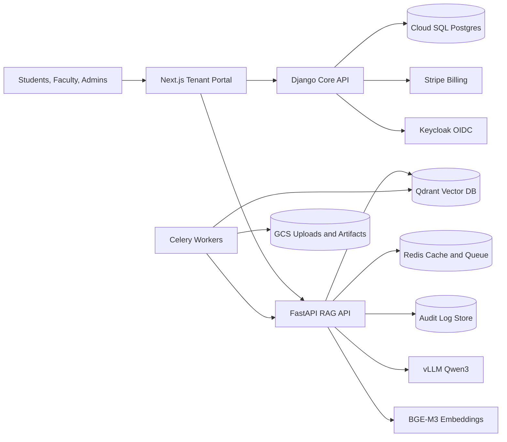
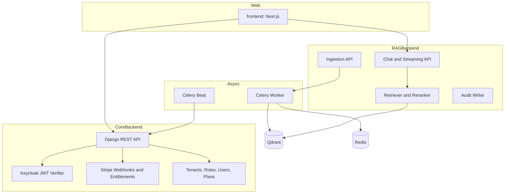
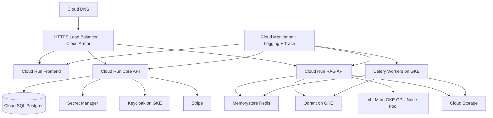

# Architecture

## System Context

## Container Architecture

## GCP Production Deployment

## Core Data Boundaries
- Postgres is the source of truth for tenants, users, roles, plans, subscriptions, entitlements, usage, API keys, source definitions, schedules, prompt versions, and invoice mirrors.
- Qdrant stores chunks and embeddings with mandatory `metadata.tenant_id` and `metadata.roles` filters.
- Redis stores Celery queue state plus short-lived auth, embedding, and response caches.
- MongoDB currently stores audit logs; for GCP production, consider moving audit logs to Postgres partitions or BigQuery if analytics becomes important.
- GCS should replace local upload paths for production source artifacts and citation files.

## AI Gateway
- Local development defaults to Ollama for generation and embeddings.
- Production should set `LLM_PROVIDER=vllm`, `VLLM_MODEL=Qwen/Qwen3-8B`, `EMBEDDING_PROVIDER=bge-m3`, and `EMBEDDING_MODEL=BAAI/bge-m3`.
- The RAG API uses an OpenAI-compatible client for vLLM so provider changes do not touch chat business logic.
